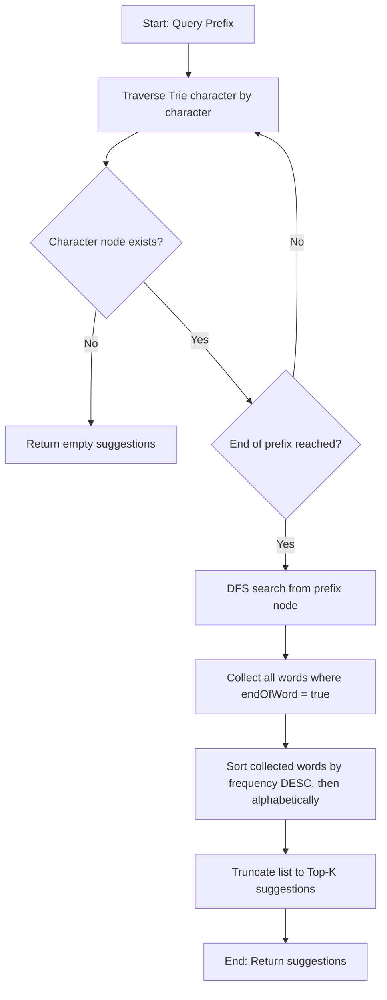

# Detailed Analysis — Autocomplete Search System

Observed during integration and performance test runs (Spring Boot 3.3, Redis 7, dataset loaded from `dataset.csv` containing 74 terms with search frequencies, client querying via REST API).

---

## 1. Role of the Components

### Trie (Prefix Tree)
The **Trie** is the core memory-based data structure of the autocomplete system. In a database of search terms, looking up words sharing a common prefix linearly becomes slow as the vocabulary size (`N`) grows. The Trie resolves this by storing strings as paths in a hierarchical tree where nodes represent individual characters.
- **Prefix Sharing**: All words sharing a prefix share the corresponding path in the tree, minimizing redundant string storage.
- **Search Optimization**: Traversal speed depends only on the length of the query prefix and the size of the matching subtree, making search times independent of the overall dictionary size.
- **Thread Safety**: In this implementation, child nodes are stored in a `ConcurrentHashMap` to allow simultaneous read operations from Tomcat threads without locking conflicts.

### Prefix
The **Prefix** is the search query substring typed by the user so far (e.g., `app`). In our architecture, the prefix represents:
- **Search Path**: The sequence of character steps (`a` -> `p` -> `p`) to traverse from the root node.
- **Subtree Root**: The node reached at the end of the prefix. This node acts as the root of the subtree containing all valid completions (suggestions) for the prefix.

### Redis Cache
The **Redis Cache** is a centralized, in-memory key-value store used to shield the Spring Boot application and memory Trie from redundant queries.
- **Traffic Distribution**: Search queries typically follow a Zipfian distribution (a tiny fraction of popular prefixes represents the vast majority of traffic).
- **Latency Shield**: By caching the resolved lists of suggestions under keys like `autocomplete:cache:<prefix>`, Redis serves repeated requests in sub-milliseconds (`< 1 ms`), completely bypassing Trie search and sorting.
- **Centralization**: Since Redis is external and centralized, multiple Spring Boot server instances can share the same cache, ensuring consistency and low resource footprint across the cluster.

### Top-K Suggestions
The **Top-K Suggestions** represent the ranked list of the `K` most popular completed words for a given prefix.
- **Relevance Ranking**: Autocomplete entries are sorted by search frequency in descending order, with alphabetical ordering acting as a tie-breaker.
- **UI Usability**: Limits the number of returned suggestions to a small value (typically `K = 5` or `K = 10`) to prevent UI layout overflow and preserve network bandwidth.
- **Performance Optimization**: Slicing the suggestions list to size `K` ensures that the payload remains small and fast to transmit.

---

## 2. How the Trie Determines Search Suggestions for a Given Prefix

The Trie resolves suggestions using the following sequence of steps:

### Step 1: Traversal
- We begin at the `root` node of the Trie.
- For each character `c` in the prefix, we look up `c` in the current node's `children` map.
- If the child node is missing at any step, the prefix does not exist in our vocabulary. We abort immediately and return an empty list.
- If we successfully match all characters in the prefix, we arrive at the prefix's sub-root node.

### Step 2: DFS Collection
- Starting from this sub-root node, we perform a Depth-First Search (DFS) recursion.
- At each visited node, we check if `endOfWord` is true. If it is, we add the stored word and its frequency (`SuggestionDto`) to a collector list.
- We recursively call DFS on all child nodes stored in the node's `children` map.

### Step 3: Sorting and Ranking
- Once DFS completes, the collector list contains all completion terms.
- We sort this list using Java's `List.sort()` with a custom comparator:
  - **Primary key**: `frequency` descending.
  - **Secondary key (tie-breaker)**: `word` alphabetical (ascending).

### Step 4: Truncation (Top-K)
- We return a sublist containing the first `min(K, list.size())` elements.

---

## 3. Autocomplete Request Workflow: Cache Hit (Prefix in Redis)

When the queried prefix has been resolved previously, the workflow is as follows:

1. **Client Request**: The client issues an HTTP `GET /api/autocomplete?prefix=app&limit=5` to the Spring Boot API.
2. **Cache Lookup**: The `AutocompleteController` forwards the request to `AutocompleteService`. The service constructs the Redis cache key: `autocomplete:cache:app`.
3. **Redis Query**: The service calls `redisTemplate.opsForValue().get("autocomplete:cache:app")` using Lettuce.
4. **Cache Response (Hit)**: Redis successfully returns the JSON-serialized list of suggestions.
5. **Deserialization**: `AutocompleteService` deserializes the JSON list into a list of `SuggestionDto` objects.
6. **Slicing**: The list (which holds up to 20 cached suggestions) is sliced to the requested limit of 5.
7. **HTTP Response**: The service wraps the suggestions in an `AutocompleteResponseDto` with the metadata `source: CACHE` and `executionTimeMs: 0` (or 1ms), and returns it to the client with an HTTP `200 OK` status.

---

## 4. Autocomplete Request Workflow: Cache Miss (Prefix NOT in Redis)

When the prefix is not cached, the workflow falls back to the Trie database:

1. **Client Request**: The client issues an HTTP `GET /api/autocomplete?prefix=app&limit=5`.
2. **Cache Lookup (Miss)**: `AutocompleteService` queries Redis for `autocomplete:cache:app`. Redis returns `null` (Cache Miss).
3. **Trie Traversal**: The service falls back to the local memory Trie by calling `TrieService.search("app", 20)`.
4. **Trie Resolution**:
   - `TrieService` traverses to the node representing `'app'`.
   - It executes a DFS to collect all descendants.
   - It sorts the collected terms by search frequency descending and returns up to 20 suggestions.
5. **Cache Update**: `AutocompleteService` serializes these 20 suggestions and saves them to Redis under key `autocomplete:cache:app` with a 10-minute Time-To-Live (TTL). Subsequent requests for prefix `app` will result in a cache hit.
6. **Slicing**: The service slices the suggestions list from 20 to the client's requested limit of 5.
7. **HTTP Response**: The service returns the suggestions wrapped in an `AutocompleteResponseDto` with metadata `source: TRIE` and the actual search execution duration, returning HTTP `200 OK`.

---

## 5. Trie-Based Prefix Search vs. Linear Search

Comparing the two search algorithms highlights the performance trade-offs:

### Complexity Comparison

| Dimension | Linear Search | Trie-Based Search |
| :--- | :--- | :--- |
| **Search Time Complexity** | `O(N * L)` | `O(P + M)` |
| **Sorting Time Complexity** | `O(M log M)` after scanning all `N` items | `O(M log M)` on matching subtree only |
| **Memory Complexity** | `O(N * L)` (Flat storage) | `O(N * L * C)` (Pointers/Map overhead) |
| **CPU Cache Locality** | High (Sequential array scans) | Low (Pointer-chasing memory jumps) |
| **Centralization Scaling** | Poor (Requires parsing full list every time) | High (Trivial subtree isolations) |

- `N`: Total vocabulary size (number of terms in the database).
- `L`: Average length of a search term.
- `P`: Length of the query prefix.
- `M`: Number of terms matching the prefix (`M << N`).
- `C`: Average alphabet size / children pointers per node.

### Computational Analysis

1. **Search Performance**:
   - In a **Linear Search**, we must scan the entire list of `N` words and check if each word starts with the prefix. For a dictionary of `N = 100,000` words, we perform 100,000 string comparisons for *every single request*.
   - In a **Trie**, we only walk down `P` nodes (e.g. 3 nodes for prefix `app`). From there, we perform a DFS to collect matching words in the subtree. The search space is instantly isolated to the matching branch. If only `M = 50` words start with `app`, our DFS and sorting operations only work on these 50 terms instead of 100,000.
2. **Sorting Overhead**:
   - A linear search filters matches across the entire database, requiring filtering operations on `N` terms. A Trie skips all non-matching branches entirely.
3. **CPU Cache and Memory Latency**:
   - While linear search has better spatial locality (elements are contiguous in memory), the sheer volume of operations (`100,000` checks vs. `P + M` which is about 53 operations) makes the Trie orders of magnitude faster.
4. **Caching Synergy**:
   - The combination of Trie-based search and Redis caching means that even the minor overhead of Trie traversals is avoided for frequently typed queries, delivering sub-millisecond latencies under production load.
