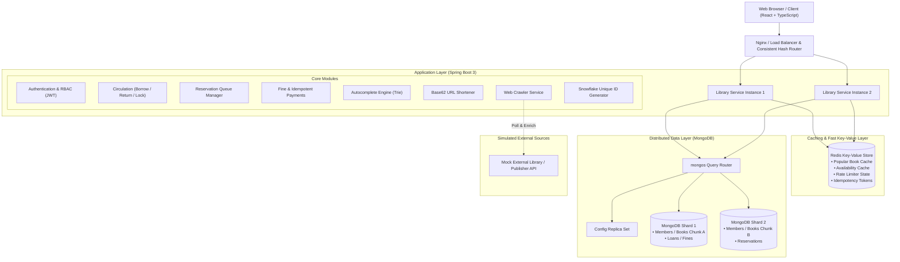
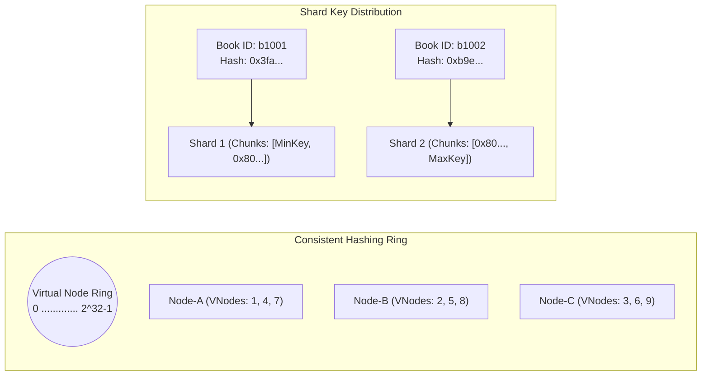

# Phase 1: System Architecture and Design
## Problem Statement 3: Scalable Library Management System

### 1. High-Level Architecture

The Scalable Library Management System is architected as a layered, modular distributed system designed for high availability, low latency, and linear horizontal scalability.



---

### 2. Component Interaction & Data Flow

```mermaid
sequenceDiagram
    autonumber
    actor Member as Library Member
    participant Gateway as API Gateway / Rate Limiter
    participant CircService as Circulation Service
    participant IdGen as Snowflake ID Gen
    participant Redis as Redis Cache
    participant Mongo as MongoDB Sharded Cluster
    
    Member->>Gateway: POST /api/circulation/borrow {bookId, memberId}
    Gateway->>Redis: Check Rate Limit (Token Bucket)
    alt Rate Limit Exceeded
        Gateway-->>Member: 429 Too Many Requests (Retry-After: 60)
    else Rate Limit OK
        Gateway->>CircService: Execute Borrow Workflow
        CircService->>Mongo: Check Member Status & Fines
        alt Has Blocking Fines
            CircService-->>Member: 400 Bad Request (Outstanding fines exceed limit)
        else Eligible
            CircService->>Mongo: Find & Atomically Claim Copy {status: "AVAILABLE"}
            alt No Copies Available
                CircService-->>Member: 409 Conflict (All copies loaned; Prompt Reservation)
            else Copy Claimed
                CircService->>IdGen: Generate 64-bit Snowflake loanId
                CircService->>Mongo: Insert Loan Document (loanId, copyId, memberId, dueDate)
                CircService->>Redis: Invalidate availability cache for bookId
                CircService-->>Member: 200 OK (Loan Created, Due in 14 days)
            end
        end
    end
```

---

### 3. Return & Reservation Queue Handover Sequence

```mermaid
sequenceDiagram
    autonumber
    actor Member as Returning Member
    participant Circ as Circulation Service
    participant ResQueue as Reservation Queue
    participant FineService as Fine Calculation
    participant Mongo as MongoDB Shards
    participant Redis as Redis Cache
    
    Member->>Circ: POST /api/circulation/return {copyId}
    Circ->>Mongo: Atomic Query Loan {copyId, status: "ACTIVE"}
    alt Loan Already Returned
        Circ-->>Member: 200 OK (Already returned - Idempotent response)
    else Active Loan Found
        Circ->>Mongo: Mark Loan RETURNED with timestamp
        Circ->>FineService: Check overdue (ReturnDate > DueDate)
        opt Overdue Days > 0
            FineService->>Mongo: Create Fine Record ($1.50/day overdue)
        end
        Circ->>ResQueue: Peek Next Active Reservation for Book
        alt Active Reservation Exists
            ResQueue->>Mongo: Assign Copy to Member 1, State: RESERVED_FOR_PICKUP
            Circ-->>Member: 200 OK (Returned; Assigned to Waiting Reservation)
        else No Reservations
            Circ->>Mongo: Update Copy Status: AVAILABLE
            Circ->>Redis: Invalidate availability cache
            Circ-->>Member: 200 OK (Returned successfully; Copy Available)
        end
    end
```

---

### 4. Sharding and Request Routing Architecture


