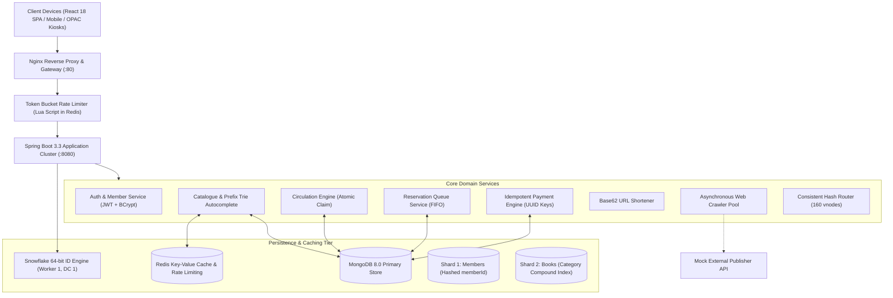
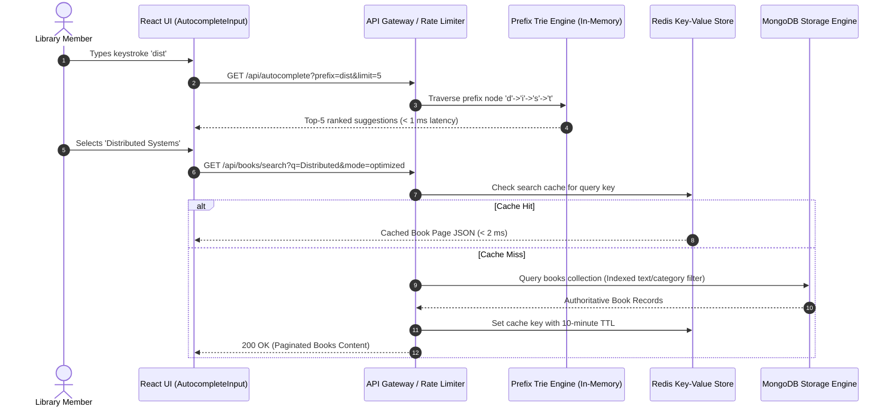
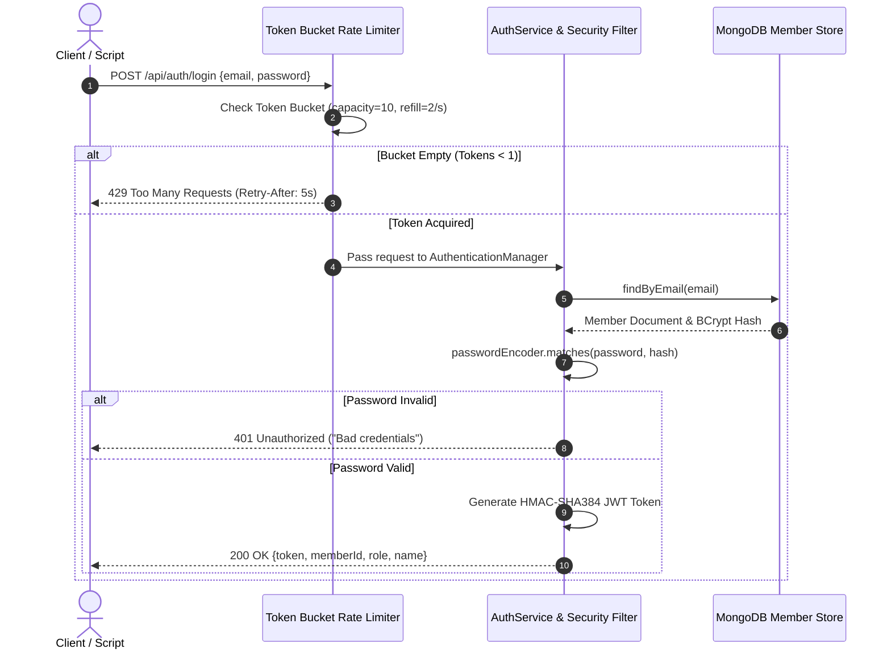
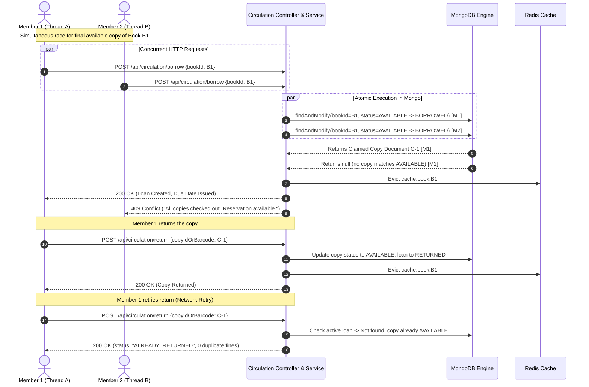
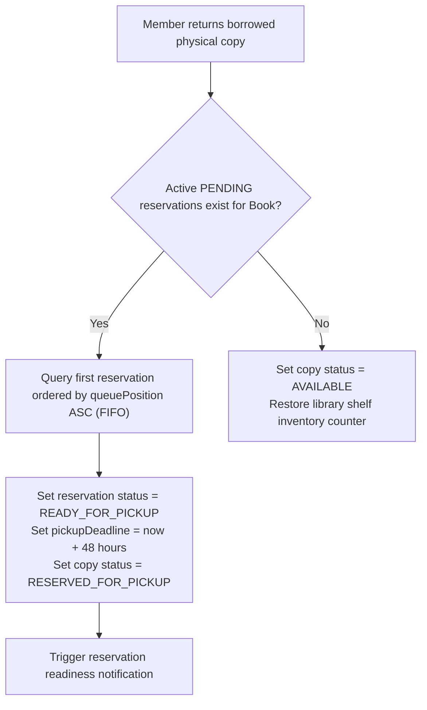
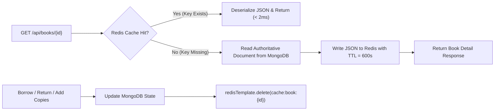
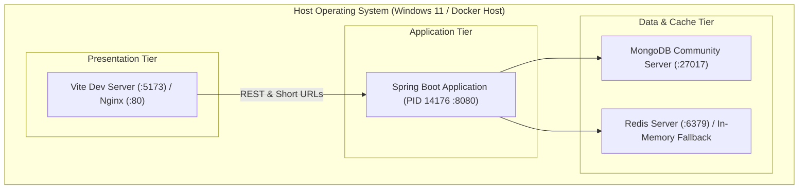

# System Architecture & Technical Design Specification
## Problem Statement 3: Scalable Library Management System
**Course**: UCS3513 — System Design Laboratory  
**Document**: Architectural Design & Technical Specification  

---

## 1. High-Level Component Architecture

---

## 2. Request Lifecycle: Book Search & Autocomplete Flow

---

## 3. Authentication & Rate-Limiting Lifecycle

---

## 4. Borrowing & Returning Concurrency Transaction Flow

---

## 5. Reservation Queue Handover Flow

---

## 6. Cache-Aside Read & Invalidation Flow

---

## 7. Deployment Architecture

---

## 8. Scaling and Failure Behavior

1. **Horizontal Backend Scaling**:
   - The Spring Boot backend is completely stateless; JWT tokens encapsulate authentication context.
   - Any number of Spring Boot instances can run behind Nginx or a Consistent Hash router.
2. **Consistent Hash Cluster Ring**:
   - Application requests are hashed using MD5 onto a 160-virtual-node ring.
   - When a server instance fails or an instance is added, only $\approx \frac{1}{N+1}$ fraction of cached keys migrate, preventing cascading cache stampedes.
3. **Redis Degradation Mode**:
   - If Redis becomes unreachable, `TokenBucketRateLimiter` degrades to thread-safe local `ConcurrentHashMap` buckets.
   - `BookService` degrades to direct MongoDB reads without throwing 500 errors.
4. **Zero Double-Borrowing Invariant**:
   - The system uses MongoDB's atomic `findAndModify` with an `AVAILABLE` status filter. Under 20 concurrent threads competing for 1 copy, exactly 1 succeeds and 19 receive HTTP 409 Conflict.
