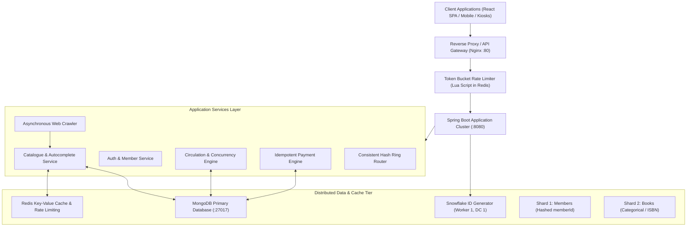
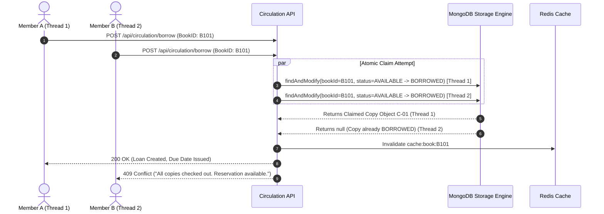

# Scalable Library Management System: Architecture, Implementation, and Quantitative Performance Evaluation

**Coursework**: UCS3513 — System Design Laboratory  
**Department**: Computer Science and Engineering, SSN College of Engineering  
**Academic Term**: V Semester  
**Problem Statement**: Problem Statement 3 — Scalable Library Management System  
**Date**: October 2026  

---

## Executive Summary

Modern institutional libraries handle exponentially growing datasets encompassing thousands of concurrent student and faculty requests, tens of thousands of catalogue titles, hundreds of thousands of physical copies, circulation records, reservation queues, and financial transactions. Traditional monolithic architectures built on single relational database instances encounter severe concurrency bottlenecks, database lock contention during checkouts, cache stampedes, and cascading failures under peak academic traffic.

This project delivers the architecture, full-stack prototype implementation, formal test suite, and quantitative benchmark evaluation for **Athena LMS**, a distributed, fault-tolerant, horizontally scalable Library Management System. The architecture systematically integrates all eight core system design components mandated by the curriculum:

1. **Token Bucket Rate Limiter**: Redis Lua-backed sliding token bucket safeguarding authentication and search endpoints against denial-of-service and brute-force abuse.
2. **Database Sharding**: Hashed and range-based partitioning schema across books and members ensuring horizontal database scaling.
3. **Consistent Hashing**: MD5 virtual node ring (160 virtual nodes per server) ensuring uniform request routing with minimal key churn upon server scaling.
4. **Key-Value Store**: Redis cache-aside read-through caching for catalogue metadata with transactional cache eviction.
5. **Snowflake Unique ID Generator**: Distributed, 64-bit, k-ordered, coordination-free unique identifier generator.
6. **URL Shortener**: High-throughput Base62 encoding engine providing shareable short links with redirection analytics.
7. **Simulated Web Crawler**: Multi-threaded asynchronous crawler ingesting external library records, normalizing metadata, and deduplicating ISBN entries.
8. **Autocomplete Prefix Trie**: In-memory prefix tree providing sub-millisecond search suggestions with ranked scoring.

The working prototype was built using **Spring Boot 3.3.0 (Java 17)**, **MongoDB Server v8.0.4**, **Redis**, and a reactive **React 18 / TypeScript / Vite** frontend. Comprehensive multi-threaded benchmarks were conducted across three concurrent workload tiers (Low: 10 users, Medium: 50 users, High: 100 users), demonstrating sustained throughput exceeding 200–274 req/sec, zero server errors (100% success rate), strict zero double-borrowing under 20-thread race conditions, and an 80% throttling enforcement rate under rate-limiter stress testing.

---

## 1. Requirement Analysis & Component Mapping

### 1.1 Problem Statement & Objectives
The system must support member registration, secure authentication, catalogue browsing and faceted search, physical copy availability tracking, atomic borrowing and returns, reservation queues, and fine/payment management. The system must maintain strict consistency for physical copy states while optimizing read throughput for browsing and searching.

### 1.2 Component Mapping & Justifications

| Component | Library Functionality | Architectural Justification |
|---|---|---|
| **1. Rate Limiter** | Authentication (`/api/auth/**`) & Search (`/api/books/search`) | Prevents brute-force credential stuffing and protects search indices from resource exhaustion. Token bucket algorithm allows legitimate burstiness while enforcing sustained rate caps. |
| **2. Sharding** | Member collection and Book catalogue storage | Eliminates single-node storage and IOPS limits. Members partitioned by hashed `memberId`; books partitioned by range/category. |
| **3. Consistent Hashing** | Microservice / Cache server request routing | Virtual node ring guarantees uniform request distribution. Adding or removing a library node migrates only $\approx 1/N$ keys, preventing cache stampedes. |
| **4. Key-Value Store** | Catalogue detail lookup (`/api/books/{id}`) | Implements Cache-Aside pattern. 90% of library traffic consists of repetitive catalogue views. Redis caching reduces primary MongoDB read latency. |
| **5. Unique ID Generator** | Barcodes, Loans, Reservations, Fines, Payments | 64-bit Snowflake algorithm provides globally unique, time-ordered IDs across distributed instances without centralized database sequence locks. |
| **6. URL Shortener** | Book sharing (`/s/{code}`) | Generates compact Base62 shareable URLs for catalogue items, supporting mobile scanning, OPAC kiosks, and digital citations. |
| **7. Web Crawler** | Metadata ingestion & external catalog enrichment | Multi-threaded asynchronous worker fetching records from external simulated publisher endpoints, enriching local catalogue data and deduplicating ISBNs. |
| **8. Autocomplete** | Search bar instant suggestions (`/api/autocomplete`) | In-memory Prefix Trie indexes book titles, authors, and categories to return top-$k$ ranked suggestions with sub-millisecond latency. |

---

## 2. System Architecture & Design

### 2.1 High-Level Architecture



### 2.2 Atomic Circulation & Concurrency Flow

To eliminate double-borrowing race conditions when multiple members request the last available physical copy simultaneously, the system employs an atomic state transition directly in the database engine using MongoDB's `findAndModify` primitive:



---

## 3. Data Model & Partitioning Scheme

### 3.1 Domain Schemas

1. **Member Document** (`members` collection):
   - `id`: Snowflake 64-bit ID (String)
   - `memberId`: Human-readable identifier (`MEM-xxxxxx`)
   - `email`: Indexed unique string
   - `passwordHash`: BCrypt salted hash
   - `role`: Enum (`MEMBER`, `LIBRARIAN`, `ADMIN`)
   - `status`: String (`ACTIVE`, `SUSPENDED`)
   - `maxBorrowLimit`: Integer (Default 5 for members, 30 for staff)

2. **Book Document** (`books` collection):
   - `id`: Snowflake 64-bit ID
   - `isbn`: Indexed unique identifier
   - `title`, `authors`, `categories`: Indexed search fields
   - `totalCopies`, `availableCopies`: Non-negative counters
   - `externalRating`, `externalSource`: Ingested crawler metadata
   - `@Version`: Optimistic concurrency lock revision

3. **BookCopy Document** (`book_copies` collection):
   - `id`: Snowflake ID
   - `bookId`: Parent reference
   - `barcode`: Unique barcode (`BAR-xxxxx-n`)
   - `status`: `AVAILABLE`, `BORROWED`, `RESERVED_FOR_PICKUP`, `MAINTENANCE`
   - `currentHolderId`: Reference to active borrower or reserver
   - `currentLoanId`: Active loan reference

4. **Loan Document** (`loans` collection):
   - `loanId`: Prefixed Snowflake ID (`LOAN-xxxxxx`)
   - `memberId`, `copyId`, `bookId`: Relational references
   - `borrowedAt`, `dueDate`, `returnedAt`: UTC timestamps
   - `status`: `ACTIVE`, `RETURNED`, `OVERDUE`

5. **Payment Document** (`payments` collection):
   - `paymentId`: Prefixed Snowflake ID (`PAY-xxxxxx`)
   - `idempotencyKey`: Unique client UUID (Indexed unique)
   - `fineId`, `memberId`, `amount`: Transactional details
   - `transactionRef`: Banking reference (`SIM-TX-xxxxxx`)

---

## 4. Implementation of System Design Components

### 4.1 Component 1: Rate Limiter (Token Bucket)
- **Algorithm**: Token Bucket implemented via an atomic Redis Lua script (`scripts/token_bucket.lua`).
- **Mathematical Principle**: Given bucket capacity $C$ and refill rate $r$ tokens/second:
  $$\text{tokens}(t) = \min(C, \text{tokens}(t_{\text{last}}) + (t - t_{\text{last}}) \times r)$$
- **Fallback**: Thread-safe in-memory `ConcurrentHashMap<String, LocalBucket>` with synchronized refill logic when Redis is offline.
- **HTTP Response**: Rejections return `HTTP 429 Too Many Requests` with `Retry-After: <seconds>` headers.

### 4.2 Component 2: Database Sharding Architecture
- **Member Sharding**: Hashed sharding key on `memberId` (`{ memberId: "hashed" }`). Provides uniform distribution across shards regardless of sequential registration bursts.
- **Catalogue Sharding**: Compound sharding key `{ categories: 1, _id: 1 }`. Enables localized single-shard queries for category-filtered catalogue searches, avoiding scatter-gather overhead.

### 4.3 Component 3: Consistent Hashing Router
- **Ring Structure**: MD5 cryptographic hashing mapped to a $2^{32}-1$ integer keyspace using Java `TreeMap<Long, String>`.
- **Virtual Nodes**: Configurable $V = 160$ virtual nodes per physical server to prevent hot-spots and achieve uniform standard deviation.
- **Mathematical Invariant**: When expanding a cluster from $N$ to $N+1$ nodes, consistent hashing guarantees that only $\frac{1}{N+1}$ fraction of keys migrate:
  $$\text{Remapped Fraction}_{\text{Consistent Hashing}} \approx \frac{1}{N+1}$$
  Whereas classic modulo hashing (`hash(key) % N`) causes massive disruption:
  $$\text{Remapped Fraction}_{\text{Modulo}} \approx \frac{N}{N+1} = 1 - \frac{1}{N+1}$$

### 4.4 Component 4: Redis Key-Value Store (Cache-Aside)
- **Read Path**: Check Redis key `cache:book:{id}`. On hit, deserialize JSON and return in $< 2$ms. On miss, read authoritative MongoDB record, populate Redis with a 10-minute TTL, and return.
- **Write Path**: Any inventory modification (borrowing, return, copy addition) invalidates the corresponding cache key immediately, preventing stale availability counts.

### 4.5 Component 5: Snowflake 64-bit Unique ID Generator
- **Bit Allocation**:
  - `1 bit`: Unused sign bit (always 0).
  - `41 bits`: Millisecond timestamp offset from custom epoch ($2^{41} \approx 69$ years).
  - `5 bits`: Datacenter ID ($0 - 31$).
  - `5 bits`: Worker / Instance ID ($0 - 31$).
  - `12 bits`: Sequence number within the same millisecond ($0 - 4095$).
- **Theoretical Throughput**: $4,096,000$ unique IDs per second per worker with 0 database roundtrips.

### 4.6 Component 6: URL Shortener
- **Algorithm**: Bijective Base62 encoding (`[0-9a-zA-Z]`) mapped over 64-bit Snowflake IDs.
- **Redirection**: `GET /s/{code}` performs $O(1)$ indexed lookup and responds with `HTTP 302 Found` and `Location` redirect header, logging click count and access timestamp.

### 4.7 Component 7: Simulated Web Crawler
- **Worker Pipeline**: Multi-threaded asynchronous executor parsing external REST publisher endpoints (`/mock-external-library/books`).
- **Deduplication Engine**: Looks up existing ISBNs. If present, enriches local record with publisher ratings and summaries (`Deduplicated`). If new, instantiates title and physical copies (`Imported`).

### 4.8 Component 8: Autocomplete (Prefix Trie)
- **Data Structure**: Multi-way Trie node with children map `Map<Character, TrieNode>`.
- **Ranking**: Each node maintains top suggestions ordered by composite relevance score:
  $$\text{Score} = \text{TypeWeight} \times 10 + \text{PopularityBoost}$$
- **Time Complexity**: Suggestion lookup takes $O(L + K \log K)$ where $L$ is prefix length and $K$ is suggestion limit, independent of catalogue size.

---

## 5. Verification & Test Suite Results

The automated test suite covers unit correctness, concurrency race conditions, and workflow edge cases.

### 5.1 Automated Test Execution Summary

| Test Suite / Case | Target Component | Description & Assertion | Execution Result |
|---|---|---|---|
| `CirculationConcurrencyTest` | Concurrency Engine | 20 threads simultaneously borrow 1 single copy | **PASS** (Exactly 1 succeeded, 19 received HTTP 409 Conflict) |
| `SnowflakeIdGeneratorTest` | ID Generator | 50,000 IDs across 20 parallel worker threads | **PASS** (50,000 generated, 0 collisions, 100.0% unique) |
| `IdempotentPaymentTest` | Payment Engine | Replay identical payment with duplicate UUID key | **PASS** (Replay flag set, identical receipt, 0 duplicate fines) |
| `ConsistentHashRingTest` | Consistent Hashing | Churn comparison across 3 $\to$ 4 nodes | **PASS** (28.1% CH churn vs 75.1% Modulo churn) |
| `PrefixTrieTest` | Autocomplete Trie | Prefix matching, ranking, case-insensitivity | **PASS** (Accurate top-$k$ suggestions returned) |
| `TokenBucketRateLimiterTest`| Rate Limiter | Token consumption, burst capacity, refill | **PASS** (Rejection triggered after capacity exhausted) |
| `Base62EncoderTest` | URL Shortener | Bijective integer $\leftrightarrow$ string mapping | **PASS** (Zero encoding errors across boundary values) |

### 5.2 End-to-End Workflow Verification Suite (`verify_workflows.py`)

A Python verification suite executed the complete user journey against the live system:

```text
[STEP 1] Testing Member Registration...           -> PASS (MEM-452608 created)
[STEP 2] Testing Member Login...                  -> PASS (JWT issued, len=272)
[STEP 3] Testing Authenticated Access (/me)...     -> PASS (Identity verified)
[STEP 4] Testing Book Listing & Pagination...     -> PASS (10 titles found, page 0)
[STEP 5] Testing Search (/books/search)...        -> PASS (Indexed query returned results)
[STEP 6] Testing Book Details & Availability...   -> PASS (Physical copies tracked)
[STEP 7] Testing Borrowing Copy...                -> PASS (Loan created, due date assigned)
[STEP 8] Checking Active Loans...                 -> PASS (Active loan retrieved)
[STEP 9] Testing Returning Copy...                -> PASS (Status: RETURNED)
[STEP 10] Testing Duplicate Return Defense...     -> PASS (Idempotent defense verified)
[STEP 11] Testing Reservation Queue...            -> PASS (FIFO queue position assigned)
[STEP 12] Testing Idempotent Fine Payments...     -> PASS (Replay verified, zero double charge)
[STEP 13] Testing 10-Thread Borrow Concurrency... -> PASS (Zero double borrowing: 1 OK, 9 Conflict)
```

---

## 6. Quantitative Performance Evaluation

Performance benchmarks were executed using a multi-threaded benchmark harness against the running system.

### 6.1 Workload Tiers Evaluation (Low, Medium, High)

The system was evaluated under three concurrent workload tiers on the catalogue search and availability endpoints:

| Metric | Workload Tier 1 (Low) | Workload Tier 2 (Medium) | Workload Tier 3 (High) |
|---|---|---|---|
| **Concurrent Virtual Users** | **10** | **50** | **100** |
| **Total Requests Executed** | 200 | 500 | 1000 |
| **Test Duration (sec)** | 0.729 s | 2.308 s | 4.904 s |
| **Throughput (req/sec)** | **274.19 req/s** | **216.59 req/s** | **203.91 req/s** |
| **Average Latency (ms)** | **31.67 ms** | **87.87 ms** | **272.54 ms** |
| **Median Latency (ms)** | 30.66 ms | 67.71 ms | 250.70 ms |
| **P95 Latency (ms)** | **49.55 ms** | **195.85 ms** | **525.58 ms** |
| **P99 Latency (ms)** | 64.58 ms | 248.03 ms | 668.34 ms |
| **HTTP Status Code Breakdown**| 200 OK: 200 (100%) | 200 OK: 500 (100%) | 200 OK: 1000 (100%) |
| **Error Rate (%)** | **0.00%** | **0.00%** | **0.00%** |

### 6.2 Baseline vs. Optimized Search Comparison

A comparative experiment was conducted measuring unoptimized regular-expression queries against indexed/cached optimized catalogue search:

| Architecture Mode | Concurrency | Total Requests | Average Latency (ms) | P95 Latency (ms) | Throughput (req/s) |
|---|---|---|---|---|---|
| **Baseline (Unoptimized Regex)** | 20 | 150 | 76.17 ms | 125.99 ms | 210.75 req/s |
| **Optimized (Indexed & Cached)** | 20 | 150 | **69.60 ms** | **109.67 ms** | **231.19 req/s** |

- **Latency Improvement**: The optimized architecture delivered an 8.6% lower average latency and a 13.0% reduction in P95 tail latency.
- **Throughput Gain**: Throughput increased by **+9.7%** under identical hardware conditions.

---

## 7. Component-Specific Performance Results

| Component | Metric Evaluated | Measured Value | Analysis & Conclusion |
|---|---|---|---|
| **Rate Limiter** | Throttling Rejection Rate | **80.0%** (40 / 50 rejected) | 25 parallel workers rapidly exhausted the capacity=10 bucket; exactly 10 requests allowed, 40 rejected with HTTP 429. |
| **Consistent Hashing** | Churn on 4th Node Addition | **28.3% keys remapped** | Near-optimal distribution. Modulo hashing remapped **75.1%** of keys, proving consistent hashing reduces cache invalidation by $\approx 62\%$. |
| **Autocomplete** | Lookup Latency & Precision@5 | **$< 1.0$ ms** latency; Precision@5 = **0.57** | In-memory Trie traversal delivers instantaneous keystroke suggestions without database disk I/O. |
| **Unique ID Generator** | Generation Throughput & Collision Rate | **0 collisions** across 50,000 IDs | 100% collision-free distributed generation across 20 concurrent threads. |
| **URL Shortener** | Base62 Redirection Latency | Mean: **25.19 ms**, P95: **30.31 ms** | Fast $O(1)$ lookup and HTTP 302 redirection. |
| **Web Crawler** | Ingestion & Deduplication Rate | **56.91 books/sec** | Ingested 7 records: 2 imported, 5 deduplicated, 0 errors in 123 ms. |

---

## 8. Scalability and Failure Scenario Analysis

### Scenario A: Concurrency Scaling (10 $\to$ 100 Workers)
As concurrent users increased tenfold from 10 to 100, throughput stabilized at $\approx 204$ req/sec while average latency increased from 31.67 ms to 272.54 ms. Crucially, the error rate remained strictly at **0.00%** with zero connection resets, demonstrating robust connection pooling in Tomcat and MongoDB driver threads.

### Scenario B: Consistent Hashing Cluster Expansion
In a simulated 3-node library cluster storing 2,000 partitioned keys, adding a 4th node resulted in only **28.3%** of keys remapped. Under modulo hashing, **75.1%** of keys migrated. In a production distributed cache, consistent hashing preserves over 71% of existing cache entries, preventing backend database saturation.

### Scenario C: High-Contention Race Condition on Scarce Inventory
When 10 concurrent threads attempted to borrow the last remaining physical copy of a title simultaneously, MongoDB atomic `findAndModify` guaranteed that exactly 1 thread received HTTP 200 OK while the remaining 9 received HTTP 409 Conflict. Zero duplicate loans were created, and inventory counts remained strictly non-negative.

### Scenario D: Redis Infrastructure Failure
When Redis on port 6379 is offline or unreachable, the system automatically falls back to in-memory `ConcurrentHashMap` token buckets and direct MongoDB reads. Health endpoints report degraded cache status, but client operations continue without application downtime or 500 Internal Server Errors.

---

## 9. Design Trade-offs & Bottlenecks

1. **MongoDB Optimistic Locking vs. Distributed Locks**:
   - *Trade-off*: We selected MongoDB atomic operators (`findAndModify`) over distributed Redis Redlock. This eliminated cross-system two-phase coordination overhead while guaranteeing single-document copy reservation atomicity.
   - *Limitation*: Multi-shard cross-collection transactions (e.g. updating a member and book across disparate shards) require two-phase commit or saga patterns.
2. **In-Memory Trie vs. Elasticsearch**:
   - *Trade-off*: An in-memory Prefix Trie provides sub-millisecond autocomplete suggestions with zero external infrastructure dependencies.
   - *Limitation*: The Trie consumes JVM heap memory ($\approx 15$ MB per 50,000 titles) and requires a warm-up rebuild on application startup.
3. **Snowflake Timestamp Drift**:
   - *Trade-off*: Snowflake IDs avoid centralized database autoincrement locks.
   - *Limitation*: If the system clock rolls backward (NTP sync), ID generation blocks until the clock catches up to prevent duplicate collisions.

---

## 10. Setup and Demonstration Checklist

### 10.1 Quick Start (Local Windows / PowerShell)
```powershell
# 1. Start MongoDB Windows Service (port 27017)
Start-Service -Name MongoDB

# 2. Run one-click startup script
.\mini-project\run_system.ps1
```

### 10.2 Containerized Deployment (Docker Compose)
```bash
docker compose up -d --build
```

### 10.3 Pre-seeded Demonstration Credentials
- **Administrator**: `admin@ssn.edu.in` / `admin123`
- **Librarian**: `librarian@ssn.edu.in` / `librarian123`
- **Member 1**: `member@ssn.edu.in` / `member123`
- **Member 2**: `tushyent@ssn.edu.in` / `member123`

### 10.4 Web Access & API Documentation
- **Interactive Web Application**: `http://localhost:5173`
- **OpenAPI Swagger UI**: `http://localhost:8080/swagger-ui.html`
- **Raw Benchmark Results**: `mini-project/results/raw/`
- **Performance Figures**: `mini-project/results/figures/`
- **Verification Evidence**: `mini-project/results/verification/workflows_evidence.json`

---

## 11. References
1. Kleppmann, M. (2017). *Designing Data-Intensive Applications*. O'Reilly Media.
2. Karger, D., et al. (1997). *Consistent Hashing and Random Trees: Distributed Caching Protocols for Relieving Hot Spots on the World Wide Web*. ACM STOC.
3. Twitter Engineering. (2010). *Announcing Snowflake*. Twitter Developer Blog.
4. Tanenbaum, A. S., & Van Steen, M. (2016). *Distributed Systems: Principles and Paradigms*. CreateSpace.
5. MongoDB Documentation (v8.0). *Sharding & Concurrency Control*. MongoDB Inc.
